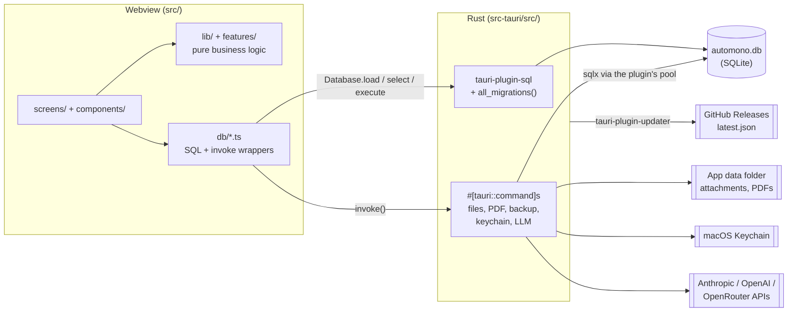

# Architecture

How AutoMono's code fits together. For setup and the PR checklist see
[CONTRIBUTING.md](../CONTRIBUTING.md); for product and design rules see
[PRODUCT.md](../PRODUCT.md) and [DESIGN.md](../DESIGN.md).

## Overview

AutoMono is a Tauri 2 desktop app for macOS. There are two runtimes and one SQLite database:

- **Frontend** (`src/`): React 19, Vite, Tailwind 4. It holds all business logic (tax math,
  validators, formatting) and does almost all CRUD itself through `@tauri-apps/plugin-sql`.
- **Backend** (`src-tauri/src/`): Rust. It owns the schema (SQL migrations) and does what the
  webview can't: copying files, generating PDFs, extracting text from PDFs, backups and restores,
  Keychain access, and outbound HTTP to LLM providers.



The frontend opens the database with `Database.load("sqlite:automono.db")` (`src/db/client.ts`,
memoised in `getDb()`). Rust commands that need the DB (`invoicing.rs`, `pdf.rs`, `backup.rs`)
borrow the same pool from the plugin's `DbInstances` state rather than opening their own
connection.

### Where logic lives

The rule: **business logic goes in TypeScript** (`src/lib/`, `src/features/`) with Vitest tests.
Rust is for IO and OS boundaries. Two exceptions worth knowing:

- `issue_invoice_cmd` / `create_rectification_cmd` (`invoicing.rs`) assign the invoice number
  atomically in one transaction and recompute totals server-side as a backstop (non-standard VAT
  forces IVA to 0%, foreign clients force IRPF to 0%, cent rounding mirrors `roundCents` in
  `src/lib/invoice.ts`).
- PDF rendering (`pdf.rs`) reads invoice/quote rows directly to lay out the document.

Everything else the user sees as a number (quarterly declarations, Modelo 347/349, analytics,
late interest, IRPF estimate) is computed in `src/lib/`.

## Frontend

### Layers

| Path                              | Role                                                                                                                                                                                                                                                                                             |
| --------------------------------- | ------------------------------------------------------------------------------------------------------------------------------------------------------------------------------------------------------------------------------------------------------------------------------------------------ |
| `src/main.tsx`, `src/App.tsx`     | Bootstraps i18n and renders `App`, which holds top-level state (invoices, clients, preferences, toasts), runs startup jobs and switches screens.                                                                                                                                                 |
| `src/screens/`                    | One component per screen, Spanish-named (`Facturas`, `Gastos`, `ResumenTrimestral`, `Ajustes`, ...). `Cobros` and `BandejaRecibos` are sub-views embedded in `Facturas` and `Gastos`, not routes.                                                                                                |
| `src/components/`                 | Shared app components: `Sidebar`, `CommandPalette` (Cmd+K), `DeclarationWizard`, `InvoiceLinesEditor`, `ModeloReviewModal`, `Modelo347Panel`, `Modelo349Panel`, `charts/` (hand-rolled SVG charts).                                                                                              |
| `src/components/ui/`              | Design-system primitives: `Badge`, `Button`, `Card`, `DataTable`, `Field`, `FormRow`, `InfoRow`, `KpiTile`, `ListRow`, `Menu`, `Popover`, `SegmentedControl`, `Sheet`, `Toast`, `Tooltip`. `Menu`, `Popover`, `Sheet` and `Tooltip` wrap Radix. Use these instead of Radix directly in a screen. |
| `src/db/`                         | Data access. One module per entity, each wrapping SQL against `getDb()`, plus the `invoke()` wrappers for Rust commands (all `invoke` calls live in `src/db/` except `src/lib/updates.ts`).                                                                                                      |
| `src/features/<entity>/`          | Pure rules per entity: client validators and tax defaults, invoice line math, quote numbering and quote-to-invoice conversion, contract extraction mapping, settings validators.                                                                                                                 |
| `src/lib/`                        | Cross-cutting pure logic, see below.                                                                                                                                                                                                                                                             |
| `src/hooks/`                      | `useCurrentQuarterKey`, `useUnsavedGuard`.                                                                                                                                                                                                                                                       |
| `src/locales/{es,en}/common.json` | All UI strings.                                                                                                                                                                                                                                                                                  |

`src/lib/` modules, one line each:

| Module                                                                          | What it does                                                                                               |
| ------------------------------------------------------------------------------- | ---------------------------------------------------------------------------------------------------------- |
| `invoice.ts`                                                                    | Cent rounding and invoice amount helpers.                                                                  |
| `quarterlyDeclaration.ts`                                                       | Which invoices/expenses fall in a period (accrual or criterio de caja) and the Modelo 303/130/111 figures. |
| `annualSummary.ts`                                                              | Full-year figures using the same math as the quarterly declaration.                                        |
| `quarterlyTrends.ts`                                                            | Quarter keys and date ranges for trend views.                                                              |
| `modelo347.ts`, `modelo349.ts`                                                  | Annual third-party operations (347) and intra-EU services (349) summaries.                                 |
| `modeloReport.ts`                                                               | Compares figures extracted from an uploaded modelo PDF with AutoMono's own totals.                         |
| `irpfEstimate.ts`                                                               | Rough full-year IRPF (Renta) estimate.                                                                     |
| `taxCalendar.ts`, `filingReminders.ts`                                          | AEAT deadlines (weekend roll-over) and the notifications before them.                                      |
| `lateInterest.ts`, `collections.ts`                                             | Overdue days, late-payment interest, payment reminder text.                                                |
| `recurring.ts`                                                                  | Advances a contract's billing anchor and drafts recurring invoices.                                        |
| `bankReconcile.ts`                                                              | Parses bank-statement CSVs and matches credit lines to invoices.                                           |
| `receiptInbox.ts`                                                               | Decides which scanned inbox files to ingest (dedupe).                                                      |
| `expenseAnomalies.ts`                                                           | Offline checks (duplicate receipts, IVA spikes, etc.) before filing.                                       |
| `analytics.ts`, `chartScale.ts`                                                 | Dashboard aggregates and chart geometry.                                                                   |
| `assistantContext.ts`                                                           | Builds the markdown snapshot sent to the tax assistant.                                                    |
| `search.ts`                                                                     | Command-palette index over clients, invoices, contracts.                                                   |
| `csv.ts`, `format.ts`, `dateRange.ts`, `countries.ts`, `status.ts`, `motion.ts` | CSV, formatting, date math, ISO country codes, status helpers, shared motion springs.                      |
| `hashRoute.ts`                                                                  | Routing (next section).                                                                                    |
| `updates.ts`                                                                    | Auto-update check and install.                                                                             |

### Routing

There is no router library. `src/lib/hashRoute.ts` maps `location.hash` to the `Screen` union in
`src/types.ts`:

- `#/factura-detalle/12` means screen `factura-detalle`, record id `12`. The path segment is the
  `Screen` value verbatim. Unknown screens fall back to `dashboard`.
- `SCREENS` lists every screen, and a compile-time check fails `tsc` if a `Screen` is added to
  the union but not to the list.
- `navigate(screen, id)` sets the hash, which pushes a history entry, so back/forward work.
- The last route is mirrored to `localStorage` (`automono:last-route`) and restored on relaunch,
  except for new/edit form screens (`NON_RESTORABLE`).
- `App.tsx` renders `Onboarding` until `preferences.onboarding_completed` is set.

### Startup jobs (`App.tsx`)

On launch the app opens the DB, then runs `checkAutoBackup()`, `runFilingReminders()`,
`runRecurringInvoices()` and a receipt-inbox folder sweep. The inbox sweep also runs whenever
the window regains focus. In production builds it checks for updates (see
[Auto-update](#auto-update)).

### i18n

`src/i18n/index.ts` sets up `i18next` + `react-i18next` with one namespace, `common`, loaded from
`src/locales/es/common.json` and `src/locales/en/common.json`. Default and fallback language is
`es`. `App.tsx` switches language from the `preferences.language` column. Add every new string
to both files.

Invoice language is separate: clients, invoices and quotes carry `language` / `invoice_language`
(`es`, `en`, `ca`), and the PDF and VAT note text follow that, not the UI language.

## Data model

All schema lives in `src-tauri/migrations/NNNN_description.sql`. Singleton settings tables use
`id INTEGER PRIMARY KEY CHECK (id = 1)` and seed their one row in the migration.

### Tables

| Table                    | Purpose                                                                                                       | Key columns and relations                                                                                                                                                                                                                                                                                                                                                                                                                                                       |
| ------------------------ | ------------------------------------------------------------------------------------------------------------- | ------------------------------------------------------------------------------------------------------------------------------------------------------------------------------------------------------------------------------------------------------------------------------------------------------------------------------------------------------------------------------------------------------------------------------------------------------------------------------- |
| `_scaffold_check`        | Health-check table from the first scaffold, used by `src/db/healthcheck.ts`.                                  | `note`                                                                                                                                                                                                                                                                                                                                                                                                                                                                          |
| `invoice_series`         | Invoice numbering series. Several clients can share one.                                                      | `prefix` (unique), `next_invoice_number`, `next_rectification_number`                                                                                                                                                                                                                                                                                                                                                                                                           |
| `clients`                | Customers.                                                                                                    | `name`, `nif_cif`, `vat_number`, `country`, `series_id` → `invoice_series`, `vat_treatment` (`standard`, `reverse_charge_eu`, `export_outside_eu`, `exempt_other`), `invoice_language`                                                                                                                                                                                                                                                                                          |
| `vat_note_templates`     | Legal VAT note printed on invoices per treatment and language.                                                | `treatment_code`, `language`, `note_text`; unique (`treatment_code`, `language`)                                                                                                                                                                                                                                                                                                                                                                                                |
| `invoices`               | Invoices and rectifying invoices.                                                                             | `client_id` → `clients` (RESTRICT), `series_prefix`, `invoice_number`, `status` (`draft`/`issued`/`paid`), `issue_date`, `due_date`, `client_*_snapshot` (name, address, NIF, VAT number, country, frozen at issue), `subtotal`, `iva_rate/amount`, `irpf_rate/amount`, `total`, `pdf_path`, `is_rectification`, `rectifies_invoice_id` → `invoices`, `rectification_type`/`reason`, `amount_paid`, `paid_date`; unique (`series_prefix`, `invoice_number`, `is_rectification`) |
| `invoice_lines`          | Invoice line items.                                                                                           | `invoice_id` → `invoices` (CASCADE), `description`, `quantity`, `unit_price`, `total`                                                                                                                                                                                                                                                                                                                                                                                           |
| `contracts`              | Client contracts and recurring billing.                                                                       | `client_id` → `clients` (CASCADE), `title`, `file_path`, `start_date`, `end_date`, `status`, `billing_cadence` (`none`/`monthly`/`quarterly`/`yearly`), `next_invoice_date`                                                                                                                                                                                                                                                                                                     |
| `expenses`               | Business expenses.                                                                                            | `date`, `paid_date`, `category`, `provider`, `amount`, `iva_amount`, `deductible_pct`, `iva_deductible_pct` (NULL = same as `deductible_pct`), `irpf_rate/amount`, `receipt_file_path`, `declared_period` (NULL = natural quarter), `declared`                                                                                                                                                                                                                                  |
| `expense_categories`     | Closed list of expense categories, seeded with defaults.                                                      | `name` (unique)                                                                                                                                                                                                                                                                                                                                                                                                                                                                 |
| `receipt_inbox`          | Receipts copied and extracted but not yet confirmed as expenses. Kept apart so drafts never reach tax totals. | `receipt_file_path`, `source_name`, `extracted_*` fields                                                                                                                                                                                                                                                                                                                                                                                                                        |
| `quotes`                 | Presupuestos. Non-fiscal: freely editable, numbered `PRE-YYYY-NNN`.                                           | `client_id` → `clients`, `year`, `seq` (unique together), `status`, `iva_rate`, `irpf_rate`, `language`, `converted_invoice_id` → `invoices` (SET NULL), `pdf_path`                                                                                                                                                                                                                                                                                                             |
| `quote_items`            | Quote line items.                                                                                             | `quote_id` → `quotes` (CASCADE)                                                                                                                                                                                                                                                                                                                                                                                                                                                 |
| `quarterly_declarations` | A filed (or in-progress) quarter. The figures are frozen in a JSON snapshot.                                  | `year`, `quarter` (unique together), `status` (`in_progress`/`completed`), `snapshot_json`, `modelo_303_path`, `modelo_130_path`, `modelo_111_path`, `gdj_rate`                                                                                                                                                                                                                                                                                                                 |
| `bank_statement_lines`   | Imported bank CSV lines for reconciliation. Re-import is idempotent.                                          | `dedupe_key` (unique), `value_date`, `amount`, `matched_invoice_id` → `invoices`, `reconciled_at`                                                                                                                                                                                                                                                                                                                                                                               |
| `business_profile`       | Singleton: the user's own business data printed on invoices.                                                  | `name`, `nif_cif`, `vat_number`, `address`, `bank_name`, `iban`, `bic`, `logo_path`                                                                                                                                                                                                                                                                                                                                                                                             |
| `business_documents`     | Uploaded registration and other business documents with LLM summaries.                                        | `file_path`, `original_name`, `label`, `summary`, `extracted_json`                                                                                                                                                                                                                                                                                                                                                                                                              |
| `preferences`            | Singleton: UI and tax preferences.                                                                            | `theme`, `language`, `default_iva_rate`, `default_irpf_rate`, `onboarding_completed`, `reta_monthly_cuota`, `reta_start_date`, `presents_modelo_111`, `criterio_caja`, `receipt_inbox_path`, `receipt_inbox_enabled`                                                                                                                                                                                                                                                            |
| `backup_settings`        | Singleton: backup configuration.                                                                              | `folder_path`, `retention_days`, `auto_backup_enabled`, `interval_days`, `last_backup_at`                                                                                                                                                                                                                                                                                                                                                                                       |
| `llm_settings`           | Singleton: selected LLM provider and per-provider model.                                                      | `provider`, `anthropic_model`, `openai_model`, `openrouter_model`. The `*_api_key` columns are legacy and blanked after keys move to the Keychain.                                                                                                                                                                                                                                                                                                                              |

### Triggers: issued invoices are immutable

Migration `0008_invoice_lock.sql` (re-created in 0009, 0013 and 0019 as columns were added)
defines:

- `trg_invoices_lock_after_issue`: once `status` is `issued` or `paid`, any change to the number,
  client, dates, snapshots, VAT fields or amounts aborts with `issued invoices are immutable`.
  Moving back to `draft` is also blocked. `issued` → `paid`, `amount_paid`, `paid_date` and
  `pdf_path` remain writable.
- `trg_invoice_lines_lock_after_issue_{upd,ins,del}`: block editing, adding or deleting lines
  of an issued or paid invoice.

Corrections go through rectifying invoices (`create_rectification_cmd`). Quotes have no such
triggers on purpose.

### Migration rules

1. **Register in two places.** Add `src-tauri/migrations/NNNN_description.sql` with the next
   number, and add a matching `Migration { version: N, ... }` entry to `all_migrations()` in
   `src-tauri/src/lib.rs`. An unregistered file never runs in the app and shows up later as a
   "no such column" error at query time. The Rust test `all_sql_files_are_registered_as_migrations`
   checks that the files on disk and the registered list match, are gap-free from `0001`, and that
   each `version` equals its file number. The frontend test `src/db/migrations.test.ts` scans the
   directory on its own, so it does not catch a registration gap.
2. **Never edit a migration that has shipped.** Installed databases have already run it.
   Add a new migration instead. (0030 dropped and recreated `business_documents` only because
   0029 had not shipped to anyone.)
3. **Never drop data.** For changes SQLite can't do with `ALTER TABLE` (changing a UNIQUE
   constraint, adding a NOT NULL foreign key, dropping columns), use create new table → copy with
   `INSERT ... SELECT` → drop old → rename new. Reference implementations:
   `0013_rectification_numbering.sql` and `0016_invoice_series.sql`. Both turn
   `PRAGMA foreign_keys` off for the rebuild, and 0013 shows that triggers referencing the rebuilt
   table must be dropped and re-created.
4. **Don't change the app identifier** (`com.nagarestudio.automono` in `tauri.conf.json`). It
   decides the data folder; see [Legacy identifier](#legacy-identifier).

## Tauri commands

Registered in `tauri::generate_handler!` in `src-tauri/src/lib.rs`. Called from the frontend
with `invoke("<name>", { ...camelCaseArgs })`.

| Command                                | Module                  | Purpose                                                                                                                    |
| -------------------------------------- | ----------------------- | -------------------------------------------------------------------------------------------------------------------------- |
| `greet`                                | `lib.rs`                | Template leftover.                                                                                                         |
| `issue_invoice_cmd`                    | `invoicing.rs`          | Issue a draft: assign the next series number, snapshot client data, set VAT note, recompute totals, lock. One transaction. |
| `create_rectification_cmd`             | `invoicing.rs`          | Create and issue a full or partial rectifying invoice for an issued one.                                                   |
| `get_or_generate_invoice_pdf_cmd`      | `pdf.rs`                | Reuse or (with `force`) render the invoice PDF via `genpdf` into `invoices/`, store `pdf_path`, open it.                   |
| `get_or_generate_quote_pdf_cmd`        | `pdf.rs`                | Same for quotes, into `quotes/`.                                                                                           |
| `attach_contract_file_cmd`             | `contracts.rs`          | Copy a contract file into `contracts/<year>/<client_id>/`.                                                                 |
| `open_contract_file_cmd`               | `contracts.rs`          | Open a contract file (path-guarded).                                                                                       |
| `extract_contract_terms_cmd`           | `contract_extract.rs`   | Read a contract PDF's text and ask the LLM for billing terms.                                                              |
| `attach_expense_file_cmd`              | `expenses.rs`           | Copy a receipt into `expenses/<year>/receipts/`.                                                                           |
| `open_expense_file_cmd`                | `expenses.rs`           | Open a receipt (path-guarded).                                                                                             |
| `delete_expense_files_cmd`             | `expenses.rs`           | Best-effort delete of a deleted expense's files (path-guarded; paths outside are skipped).                                 |
| `extract_receipt_fields_cmd`           | `receipt_extract.rs`    | Parse date, amount, IVA, IRPF, vendor from a receipt PDF's text layer with hand-written rules. No network.                 |
| `extract_receipt_fields_llm_cmd`       | `receipt_extract.rs`    | Same fields (plus category) via the LLM, sending the PDF or image.                                                         |
| `list_receipt_inbox_files_cmd`         | `receipt_inbox.rs`      | List pdf/png/jpg files in the watched folder, skipping dotfiles and files written in the last 3 s.                         |
| `ingest_receipt_cmd`                   | `receipt_inbox.rs`      | Copy a receipt into the archive, extract fields, optionally delete the source (folder sweep only).                         |
| `attach_business_logo_cmd`             | `branding.rs`           | Copy the logo to `branding/logo.<ext>`, replacing any previous one.                                                        |
| `attach_business_document_cmd`         | `business_documents.rs` | Copy a document into `documentos_autonomo/`.                                                                               |
| `extract_business_document_fields_cmd` | `business_documents.rs` | LLM extraction of name, NIF, address, IBAN, RETA start date and a summary.                                                 |
| `open_business_document_file_cmd`      | `business_documents.rs` | Open a business document (path-guarded).                                                                                   |
| `read_user_context_cmd`                | `user_context.rs`       | Read `contexto_usuario.md` (empty string if missing).                                                                      |
| `write_user_context_cmd`               | `user_context.rs`       | Write `contexto_usuario.md`.                                                                                               |
| `synthesize_user_context_cmd`          | `user_context.rs`       | LLM: merge document summaries into one markdown context file.                                                              |
| `ask_assistant_cmd`                    | `assistant.rs`          | Send the frontend-built context plus conversation to the LLM; return the reply.                                            |
| `write_text_file_cmd`                  | `export.rs`             | Write text (e.g. CSV) to a user-picked path.                                                                               |
| `read_text_file_cmd`                   | `export.rs`             | Read a user-picked text file (bank CSV), lossy UTF-8.                                                                      |
| `export_gestor_bundle_cmd`             | `export.rs`             | Build an accountant folder: `facturas/`, `gastos/`, `resumen.csv`.                                                         |
| `attach_declaration_file_cmd`          | `declarations.rs`       | Copy a filed modelo into `declarations/<year>/<year>-Q<q>_modelo<n>.<ext>`.                                                |
| `open_declaration_file_cmd`            | `declarations.rs`       | Open a declaration file (path-guarded).                                                                                    |
| `export_declaration_zip_cmd`           | `declarations.rs`       | Zip a declaration's invoice PDFs, receipts and CSV.                                                                        |
| `detect_modelo_cmd`                    | `modelo_review.rs`      | Detect which modelo (303/130/111) a PDF is and its period.                                                                 |
| `extract_modelo_fields_cmd`            | `modelo_review.rs`      | Extract a modelo's headline figures; uses the LLM when configured, else text rules (`used_fallback`).                      |
| `get_llm_api_key_cmd`                  | `keychain.rs`           | Read a provider's API key from the Keychain.                                                                               |
| `set_llm_api_key_cmd`                  | `keychain.rs`           | Store a key (blank clears it).                                                                                             |
| `clear_llm_api_key_cmd`                | `keychain.rs`           | Delete a key.                                                                                                              |
| `backup_now_cmd`                       | `backup.rs`             | Run a backup to the configured folder.                                                                                     |
| `backup_before_update_cmd`             | `backup.rs`             | Backup before installing an update.                                                                                        |
| `restore_backup_cmd`                   | `backup.rs`             | Validate, restore and relaunch.                                                                                            |
| `list_backups_cmd`                     | `backup.rs`             | List `backup-*` folders containing `automono.db`, newest first.                                                            |
| `open_backup_folder_cmd`               | `backup.rs`             | Open a folder in Finder.                                                                                                   |

Modules without commands: `llm.rs` (multi-provider client, see below), `legacy_data.rs`
(identifier migration), `main.rs` (entry point).

Shared helpers in `contracts.rs`: `year_of` (year folder from an ISO date, `0000` for anything
that isn't four digits), `copy_into` (copy with a readable name and a `_1`, `_2` suffix on
collision, never overwriting), `path_within` / `ensure_under_data_dir` (path guard).

## Security

- **CSP** (`tauri.conf.json`): scripts only from `'self'`; styles from `'self'`, inline and
  Google Fonts; images from `'self'`, the asset protocol and `data:`; `connect-src` is only Tauri
  IPC. The webview cannot make network requests itself, so LLM calls and update checks run in
  Rust.
- **Asset protocol** is enabled only for `$APPDATA/branding/*` and `$APPDATA/expenses/**`
  (logo and receipt previews).
- **Capabilities** (`src-tauri/capabilities/default.json`, window `main`): `core:default`,
  `core:window:allow-destroy`, `opener:default`, `sql:default`, `sql:allow-execute`,
  `dialog:default`, `notification:default`, `updater:default`, `process:allow-restart`. There is
  no `fs` plugin; file access goes through the commands above.
- **Path guarding**: commands that open or delete a stored file (`open_*_file_cmd`,
  `delete_expense_files_cmd`) canonicalize the path and reject anything outside `app_data_dir()`,
  so `..` and symlinks can't escape. Attach commands read from a user-picked source path and
  always write inside the data folder. The export and text-file commands write to or read from
  paths the user picks in a native dialog and are not guarded.
- **API keys** are in the Keychain, not SQLite (next section).

## Keychain and LLM calls

`keychain.rs` stores one Keychain entry per provider (`anthropic`, `openai`, `openrouter`) under
the service `com.nagarestudio.automono`. The rest of `llm_settings` (selected provider and model
overrides) stays in SQLite. On a miss, `get` checks the old service name
(`com.aryancuriel.automono`), copies the key across and deletes the old entry. `clear` removes
both. `src/db/llmSettings.ts` moves any key still stored in plaintext in `llm_settings` into the
Keychain on first load and nulls the column.

LLM calls run in Rust (`llm.rs`, using the `rig` crate):

- `extract<T>` sends one content block (PDF, image or text) with a preamble and parses a typed,
  JSON-schema-described result. Used by receipt, contract, business document, modelo and context
  extraction.
- `chat` sends a preamble plus conversation history and returns free text. Used by the assistant.
- Default models: Anthropic `claude-haiku-4-5`, OpenAI `GPT_5_2` from `rig`. OpenRouter has no
  default; a model must be set in Ajustes.

The frontend reads the key with `get_llm_api_key_cmd` and passes `provider`, `api_key` and
`model` into each LLM command. The assistant's grounding context is built in TypeScript
(`src/lib/assistantContext.ts`); `assistant.rs` only relays it.

## App data folder

The data folder is `~/Library/Application Support/com.nagarestudio.automono/`. The SQLite plugin
opens the DB under `app_config_dir()` and attachments live under `app_data_dir()`; on macOS both
resolve to this folder.

```
automono.db                         SQLite database
contracts/<year>/<client_id>/       <start_date>_<original-name>.<ext>
expenses/<year>/receipts/           <date>_<note-or-vendor>.<ext>
invoices/                           <number-label>.pdf (generated)
quotes/                             <PRE-YYYY-NNN>.pdf (generated)
declarations/<year>/                <year>-Q<q>_modelo<303|130|111>.<ext>
documentos_autonomo/                <original-name>.<ext>
branding/                           logo.<ext>
contexto_usuario.md                 assistant context memory
pre-update-backups/                 backups before updates, if no backup folder is set
```

Attachment folders use the record's business date (expense date, contract start date), not the
attach time, so the folder doubles as a per-tax-year archive an accountant can browse. The DB
stores absolute paths to these files.

### Legacy identifier

The identifier was once `com.aryancuriel.automono`. Before Tauri starts, `run()` calls
`legacy_data::migrate_for_identifier`: if the old folder has a DB and the new one doesn't, it
copies the folder to a staging location, verifies the copy, rewrites every TEXT column value that
starts with the old folder path (all tables, discovered at runtime), and renames it into place.
The old folder is left untouched. If this fails the app panics instead of starting on an empty
database. `rewrite_paths` also runs after a restore, for backups taken under the old identifier.

## Backups

All in `backup.rs`; settings live in `backup_settings`, the UI in `Ajustes`.

**What a backup is.** `run_backup` creates `<folder>/backup-<YYYY-MM-DDTHH-MM-SS>/` containing:

- `automono.db`, written with `VACUUM INTO` (a consistent snapshot even with the app open),
- copies of `contracts`, `expenses`, `invoices`, `declarations`, `documentos_autonomo` and
  `branding` (`quotes/` is not included),
- `contexto_usuario.md` if present,
- `manifest.json`: path, size and SHA-256 of every file in the snapshot.

It then updates `last_backup_at`.

**When backups run.**

| Trigger          | Where                                                                                                                                                                   |
| ---------------- | ----------------------------------------------------------------------------------------------------------------------------------------------------------------------- |
| Manual           | `backup_now_cmd` from Ajustes. Needs a folder set.                                                                                                                      |
| Startup catch-up | `checkAutoBackup()` in `src/db/backup.ts`, called from `App.tsx`.                                                                                                       |
| Window close     | `backup_on_close` from `on_window_event`, only if auto-backup is enabled and `interval_days` have passed. Capped at 10 s so an unreachable folder can't block quitting. |
| Before an update | `backup_before_update_cmd`. Uses the configured folder, or `pre-update-backups/` in the data folder (never pruned).                                                     |

**Retention.** After each backup, folders named `backup-*` older than `retention_days` are
deleted. `retention_days <= 0` keeps everything.

**Restore** (`restore_backup_cmd`):

1. Validate the backup DB read-only: `PRAGMA quick_check` must pass and `clients` and `invoices`
   must exist. A bad pick fails here with the app untouched.
2. Close the live DB pool.
3. If `manifest.json` exists, verify every file's size and hash. Older backups without a manifest
   are rejected if an attachment folder is empty while the live one has files.
4. Copy each folder and the DB to `*.restoring` siblings.
5. Swap them in with renames (live folder → `*.old` → removed), delete stale `-wal`, `-shm` and
   `-journal` files, rename the DB into place, and copy `contexto_usuario.md`.
6. Run `legacy_data::rewrite_paths` for old-identifier backups.
7. `app.restart()`. The closed pool can't be reopened in-process, so the app relaunches.

## Auto-update

- `tauri-plugin-updater` checks `latest.json` on the latest GitHub Release
  (`plugins.updater.endpoints` in `tauri.conf.json`). The update must be signed with the key whose
  public half is in `plugins.updater.pubkey`.
- `.github/workflows/build-macos.yml` builds, signs and publishes the release and `latest.json`
  when a `v*` tag is pushed (`just release`). `bundle.createUpdaterArtifacts` is on.
- `App.tsx` calls `checkForUpdate()` once on launch in production builds and shows a toast if
  one is available; errors are ignored. Ajustes has a manual check.
- `installUpdate()` in `src/lib/updates.ts` runs `backup_before_update_cmd`, then
  `update.downloadAndInstall()`, then `relaunch()` from `plugin-process`.

## Testing

| Suite            | How to run                                                                                     | What it covers                                                                                                                                                                                                                                                                                                               |
| ---------------- | ---------------------------------------------------------------------------------------------- | ---------------------------------------------------------------------------------------------------------------------------------------------------------------------------------------------------------------------------------------------------------------------------------------------------------------------------- |
| Vitest           | `bun run test` (one file: `bun run test src/lib/recurring.test.ts`, one test: add `-t "name"`) | Pure logic in `src/lib/` and `src/features/`, plus SQL tests in `src/db/*.test.ts`. No separate Vitest config; it uses `vite.config.ts`.                                                                                                                                                                                     |
| Migration replay | part of `bun run test`                                                                         | `src/db/migrations.test.ts` reads every `.sql` file in `src-tauri/migrations/` in name order and runs it against an in-memory `node:sqlite` `DatabaseSync` with foreign keys on, then tests constraints, seeds and triggers. Other `src/db/*.test.ts` files use the same approach.                                           |
| Rust             | `cd src-tauri && cargo test`                                                                   | Inline `#[cfg(test)] mod tests` per module: migration registration, invoicing, PDF generation, receipt parsing, backup/restore (corrupt, incomplete, tampered, legacy backups), legacy data migration, path guards, export bundles. Keychain tests run only on macOS against the real login Keychain with throwaway entries. |

CI (`.github/workflows/ci.yml`) runs `bun run lint`, `bun run test`, `bun run build` and
`cargo test` on every pull request.
